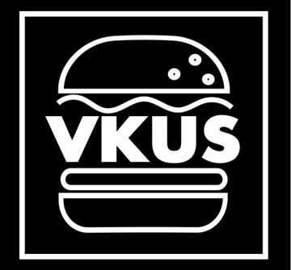

<div align="center">

# Mobile Apps

**Прототипы мобильных приложений на React Native и Flutter**


</div>

---

## 🍔 [vkusno-i-tochka](vkusno-i-tochka) · React Native + Expo



Учебный прототип меню фастфуд-ресторана в стиле «Вкусно — и точка»: главный экран с категориями и популярными позициями, карточка товара и переходы между экранами.

- навигация через `@react-navigation/native-stack`
- карточка товара с горизонтальной галереей популярных позиций, открывается на выбранном блюде
- жесты на карточке товара: двойной тап увеличивает фото, долгое нажатие показывает подсказку, свайп вниз закрывает экран (`react-native-gesture-handler`)
- компонентная структура `src/components`, данные отделены от вёрстки, цвета и размеры вынесены в `constants.js`

```bash
cd vkusno-i-tochka
npm install
npx expo start
```

Изображения блюд подгружаются с сайта ресторана; проект некоммерческий и сделан для практики.

## 🏠 [smart-home-flutter](smart-home-flutter) · Flutter

Панель управления умным домом: свет, термостат с регулировкой температуры, замки и камеры. Плитки меняют иконку и подпись по состоянию, интерфейс построен на `GridView` и `StatefulWidget`.

```bash
cd smart-home-flutter
flutter create .   # сгенерировать платформенные папки
flutter run
```

---

<p align="center"><sub>part of <a href="https://github.com/cent0n1y">cent0n1y</a> · 01</sub></p>
